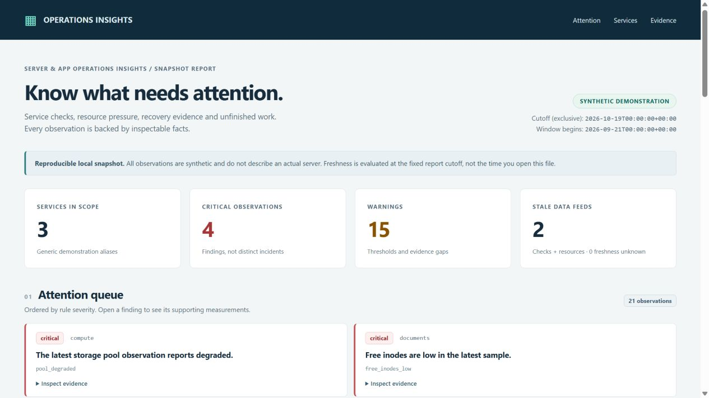
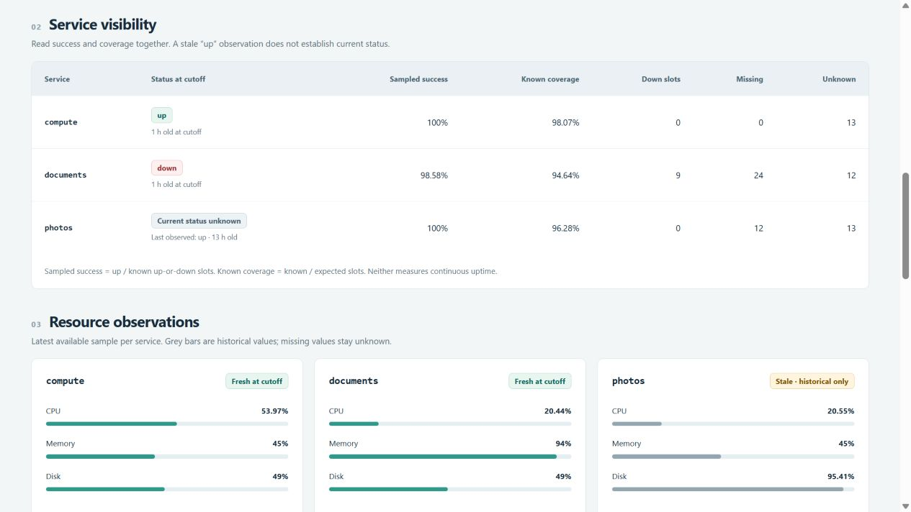
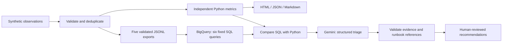

# Server & App Operations Insights

**Know what needs attention on a server—and see the evidence behind it.**

[](https://github.com/Quaeritate/gcp-ai-analytics-demo/actions/workflows/ci.yml)
[](pyproject.toml)
[](LICENSE)

Built by **[Matej Bicej](https://github.com/Quaeritate)**. A Python operations
analytics project with a standalone dashboard, six BigQuery SQL analyses and
structured Gemini triage through Google Cloud / Vertex AI.



**Working today:** deterministic local analytics, JSON/Markdown/HTML reports,
validated warehouse exports, bounded cloud adapters and offline tests.
**Live verification pending:** BigQuery execution, Gemini model quality, cloud
billing and cleanup. All published data and screenshots are synthetic.
See the [verification record](docs/verification.md) for the evidence boundary.

## Why this project

A server can have recent backups but no recent restore test. A service can show
100% sampled success while monitoring has gone silent. A job can succeed after
several retries. Combining those signals without their context produces a
misleading health dashboard.

This project makes those distinctions visible for someone running personal
infrastructure and building applications on it:

| Decision | Evidence in the report |
| --- | --- |
| What needs attention first? | Severity-ranked findings with expandable supporting measurements |
| Are services usable and monitored? | Up/down/unknown checks, sampled success, coverage and freshness |
| Is capacity under pressure? | CPU, memory, disk usage, inodes and storage-health summaries |
| Is data protection current? | Backup success age and latest failures, separate restore-test evidence |
| Which application work needs review? | Final outcomes, extra attempts, blocked/running work and pending age |

Missing measurements stay unknown. Stale high readings remain historical.
The [38-question roadmap](docs/server-insight-catalog.md) covers future sources
including capacity trends, queues, dependencies, UPS and recovery access.

## Try it

No Google Cloud account is needed for the local demo. Use Python 3.12.

```powershell
python -m venv .venv
.\.venv\Scripts\python.exe -m pip install -r requirements-dev.lock
.\.venv\Scripts\python.exe -m pip install --no-deps --no-build-isolation -e .
.\.venv\Scripts\python.exe -m gcp_ai_analytics demo-local --seed 42 --output artifacts/local/server-demo
```

On macOS/Linux, use `python3` to create the environment and `.venv/bin/python`
for subsequent commands. Open `artifacts/local/server-demo/report.html` in a
browser. It needs no web service, JavaScript, external assets or credentials.

For a preview without installing, read the [example report](examples/synthetic/report.md),
inspect [its JSON](examples/synthetic/report.json), or download and open the
[standalone HTML](examples/synthetic/report.html).
The [demo guide](docs/demo-guide.md) provides a five-minute walkthrough.

The fixed fixture contains **2,513 records across three service aliases over
28 days**, producing 21 deliberately constructed findings. Seed `42`, generator
version and the dataset hash make the output reproducible. The reporting cutoff
is fixed at October 19, 2026; freshness is evaluated at that cutoff.



## Architecture



The cloud branch requires explicit execution. SQL remains fixed and parameterized.
The combined path rejects metric mismatches before Gemini receives returned SQL
aggregates. The model cannot execute SQL, commands or remediation. Its response
references known facts and reviewed checks; those references are validated and
numeric evidence is rendered by Python. Prose still needs human review.

Read the [architecture and trade-offs](docs/architecture.md),
[BigQuery implementation](docs/bigquery.md), and
[AI evaluation design](docs/ai-evaluation.md).

## Prepare the cloud workflow offline

```powershell
.\.venv\Scripts\python.exe -m gcp_ai_analytics plan-cloud --input examples/synthetic/synthetic_server_data.json --project example-project --output artifacts/local/cloud-plan
.\.venv\Scripts\python.exe -m gcp_ai_analytics evaluate-ai --output artifacts/local/corpus-check
```

`example-project` is a placeholder. Planning writes five exports, a manifest,
resource/query limits and an AI preview without contacting Google Cloud.
The 24-case corpus includes missing/stale data, held work, successful retries,
backup/restore confusion, ambiguous causes and prompt injection. Offline corpus
validation is **not measured model accuracy**.

See [cloud setup](docs/cloud-setup.md) for opt-in commands and
[costs, security and cleanup](docs/security-and-costs.md) for the request limits.
The local demo has no cloud charge. A bounded cloud smoke test is estimated at
roughly a few cents under the documented assumptions; no live bill is claimed.

## Validation and project map

```powershell
.\.venv\Scripts\python.exe -m pytest -q
.\.venv\Scripts\python.exe -m ruff check src tests
.\.venv\Scripts\python.exe -m ruff format --check src tests
.\.venv\Scripts\python.exe -m pip check
```

CI checks Windows and Linux on Python 3.12 without cloud secrets. Tests cover
hand-calculated metrics, boundaries, malformed inputs, deterministic output,
HTML escaping, export integrity, request limits and SDK serialization using an
in-process mock transport. No paid service is required.

| Location | Contents |
| --- | --- |
| [`src/gcp_ai_analytics`](src/gcp_ai_analytics) | Contracts, generator, analytics, renderers, CLI and cloud adapters |
| [`src/gcp_ai_analytics/sql`](src/gcp_ai_analytics/sql) | Six reusable BigQuery SQL analyses |
| [`schemas`](schemas) | Machine-readable synthetic input contract |
| [`tests`](tests) | Offline correctness and failure-path tests |
| [`examples/synthetic`](examples/synthetic) | Reproducible data and generated reports |
| [`docs`](docs) | Architecture, demo, costs, evaluation and evidence |

This is a portfolio prototype, not a live monitoring service. It does not collect
private infrastructure data or prove production readiness. A future private
adapter follows a [separate integration plan](docs/practical-use-proposal.md).

MIT licensed. Copyright 2026 Matej Bicej.
