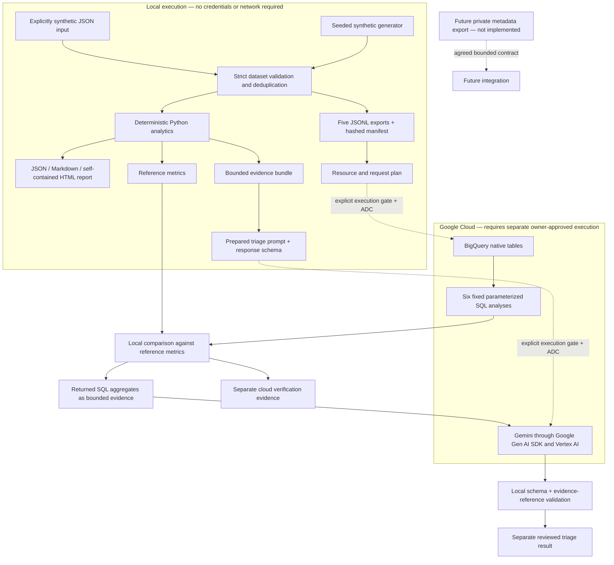

# Architecture

Server & App Operations Insights turns bounded observations into facts an operator
can inspect. The project starts with a synthetic, reproducible local workflow and
has separate, guarded BigQuery and Gemini paths. A report can be generated without
Google Cloud credentials, a running web service, or a connection to a server.

## Data flow and execution boundaries

The HTML report displays deterministic calculations. Gemini output is a separate
artifact and cannot replace the report's measurements, change rule severities, or
execute commands. Cloud execution evidence is also separate: a successful local
test or export does not establish that a BigQuery query or model request worked.
The combined `cloud-demo` command requires BigQuery results to match the local
reference before proceeding to Gemini with the returned SQL aggregates.
Local rule selection determines which findings to explain; event IDs and other
local-only details are excluded from that cloud evidence. Separate `triage` requests use the local
reference report as their evidence source.

## Modules and responsibilities

| Module | Responsibility |
| --- | --- |
| `contracts.py` | Validate explicitly synthetic input, normalize timestamps, reject conflicting event IDs and unsupported fields, and deduplicate identical events. |
| `generate_data.py` | Produce repeatable observations from a fixed reporting window and seed. Include good observations, failures, stale sources, incomplete monitoring and recovery gaps. |
| `analytics.py` | Calculate service checks, resources, backups, restore evidence, jobs and evidence-backed findings without I/O. |
| `reporting.py` | Serialize canonical JSON and a readable Markdown report. |
| `html_report.py` | Render escaped report facts into a portable, responsive HTML file, including native evidence disclosures and print styles. No scripts, remote assets or runtime dependencies. |
| `cli.py` | Validate local inputs, invoke the appropriate workflow and protect differing existing output files from overwrite. |
| `bigquery_pipeline.py` and `sql/` | Export five schema-defined tables, prepare a bounded plan, run explicitly authorized cloud work and compare fixed query results with local reference metrics. |
| `gemini_client.py` | Prepare a bounded evidence bundle, make explicitly authorized structured-output requests and validate returned references and reviewed runbook-check identifiers. |
| `evaluation.py` and `evaluation_cases.json` | Exercise structured triage validation with offline cases; keep actual model evaluation separate from local fixtures. |

Both cloud modules have offline preparation paths. Their live paths remain
unverified until a separately authorized run records observed results. See the
[verification record](verification.md) for what has actually been exercised and
the [cloud setup plan](cloud-setup.md) for the approval and cost boundaries.

## Technology choices

- **Python 3.12+ and Pydantic:** one small application with an explicit input
  contract and testable calculations. Validation happens before analytics or
  export, so invalid timestamps and ambiguous job snapshots cannot quietly change
  a metric.
- **Static HTML, Markdown and JSON:** a human-readable report, a review-friendly
  text artifact and a machine-readable record from the same facts. The HTML file
  opens locally; it does not need hosting, JavaScript, a database or an account.
- **BigQuery:** an optional analytical-history path with five native tables,
  fixed SQL and comparison against the Python implementation. SQL is reviewed
  source code, never generated by a model at runtime.
- **Google Gen AI SDK through Vertex AI:** an optional triage path over a bounded
  synthetic evidence bundle. It selects evidence and reviewed checks, while
  structured validation constrains the result. It has no command or SQL tools.
- **Pytest and Ruff:** offline correctness checks and static code checks. Cloud
  integration is an explicit, separate activity.

## What the facts mean

The report window is `[window_start, as_of)` in UTC. Its fixed end is exclusive;
all freshness and age calculations use that boundary. Opening an old report
does not make it a live status page.

| Design rule | Practical consequence |
| --- | --- |
| Unknown is distinct from zero | No measurements, no known check outcomes and no completed job outcomes retain missing values. |
| Success needs coverage context | A service can have 100% sampled success and still have missing observations. The report displays both figures. |
| Stale observations remain historical | A stale `up` check becomes “Current status unknown”; old resource values remain visible without current threshold alerts. |
| Backups and restores are separate | A successful backup or checksum does not prove recovery. Restore evidence has its own age and outcome. |
| Retries and failures are separate | Multiple attempts do not imply a final failure. Pending runs retain their own counts and elapsed age. |
| Findings cite inputs | Each finding includes measured evidence, relevant targets and event references where available. |

Demonstration thresholds are assumptions, not hardware or service guarantees.
Point measurements cannot establish sustained load, storage exhaustion dates or
root causes. Complete definitions are included in each report and in the
[implementation plan](stage-0-plan.md).

## Extension path

The [server insight catalog](server-insight-catalog.md) describes the broader
roadmap. The current schema covers a useful first slice: checks and visibility,
latest CPU/memory/storage observations, backup and restore evidence, and job
outcomes. Capacity forecasting, dependency correlation, power, network,
certificate, change-history and deeper application analysis need additional
qualified fields and histories before they can produce defensible conclusions.

A private integration starts with an agreed, bounded metadata export and a
separate privacy review. It must not relabel real data as synthetic. Live
collectors, remediation, access changes and production deployment are outside the
implemented workflow. Public fixtures and demonstrations remain synthetic.
